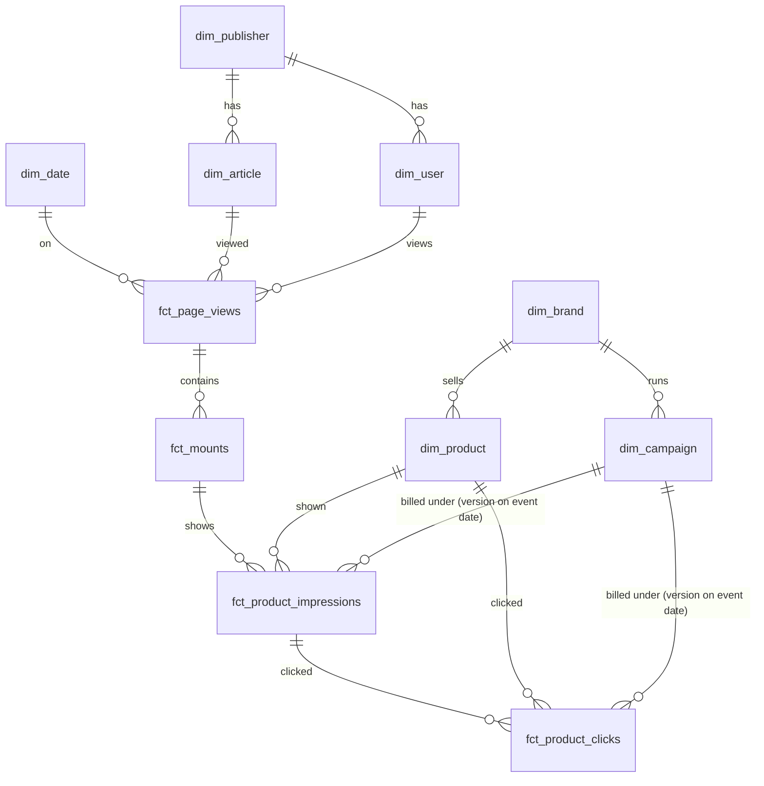

# Data model

The model is a **star schema** built in four layers. Each layer only reads
from the layer(s) before it, so any table can be rebuilt by re-running the
pipeline.

```
raw parquet + CSV  ->  01_staging  ->  02_dimensions  ->  03_facts  ->  04_marts / 05_analysis
```

## Entity diagram



## Event funnel

One page load (`page_view_id`) moves through:

`TagLoaded` (1 per page view) -> `Mounts` (ad units placed on images) ->
`ProductImpressions` (1 event per image, many products) -> `ProductClick`.

## Tables

### Staging (`sql/01_staging`) - clean, typed, one row per raw item

| Table | Grain | Notes |
|---|---|---|
| `stg_events` | event (`event_id` = `eid`) | Context flattened; `event_date` from the partition file name; duplicates on `eid` removed; invalid rows go to `stg_events_rejected` |
| `stg_events_rejected` | rejected event | Quarantine with `reject_reason` |
| `stg_tagloads` | page view | One TagLoaded per page view |
| `stg_mounts` | page view x image | `mounts[]` unnested |
| `stg_product_impressions` | product entry in an impression event | `products[]` unnested, **not** de-duplicated; event payload fields prefixed `event_` |
| `stg_product_clicks` | click (`click_id`) | |
| `stg_products`, `stg_campaigns` | CSV row | Explicit column types (auto-detection reads the empty `cpm_rate` as text) |

### Dimensions (`sql/02_dimensions`)

| Table | Key | Notes |
|---|---|---|
| `dim_date` | `date_day` | Calendar attributes, weekend flag |
| `dim_publisher` | `publisher_id` | Domain |
| `dim_article` | `article_url` | Brief: URL identifies the article |
| `dim_user` | `user_key` = `publisher_id:device_id` | Device id is only unique per publisher; device type parsed from user agent |
| `dim_brand` | `brand_id` | Name/domain taken from campaign data |
| `dim_product` | `product_id` | Trusted source of brand; `current_price`, `is_on_sale` |
| `dim_campaign` | `campaign_sk` (SCD2 version) | `billing_type` inferred from rate columns when `product_type` is blank, flagged by `is_billing_type_inferred` |

### Facts (`sql/03_facts`)

| Table | Grain | Key measures |
|---|---|---|
| `fct_page_views` | page view | mounted_images, impressed_images, product_impressions, clicks, has_* flags |
| `fct_mounts` | page view x image | mount_index |
| `fct_product_impressions` | page view x image x product | impression_occurrences (raw count before de-dup), advertised_price, campaign_sk |
| `fct_product_clicks` | click | advertised_price, cpc_revenue |

### Marts (`sql/04_marts`) - reusable aggregates

| Table | Grain | Use |
|---|---|---|
| `agg_daily_domain_funnel` | day x publisher | traffic, users, mount rate, impressions, clicks, CTR |
| `agg_daily_product_performance` | day x product x campaign version | impressions, clicks, CTR, estimated revenue (CPC & CPM; CPA needs sales data) |

## Key modelling decisions

1. **Event date = partition date.** The data is partitioned by generation date;
   `event_created_at` is ingestion time. 1,091 events (0.08%) were ingested
   after midnight and would otherwise land on the wrong day.
2. **Brand comes from `dim_product`, not the event payload.** The event's
   `brand_id` disagrees with the product's real brand for ~75% of impression
   rows and 1,044 of 1,402 clicks (e.g. a Forever New skirt tagged with
   Oz Home Hub's brand id).
3. **Impressions are de-duplicated** to page view x image x product. ~25% of
   product entries are exact repeats inside the same event. The raw count is
   kept in `impression_occurrences`.
4. **Campaign is joined as of the event date** (SCD Type 2). Oz Home Hub's CPC
   rate changed from 0.50 to 0.75 on 2025-05-13; clicks before and after are
   tied to the correct rate. There is no campaign id in the events, so the link
   is product -> brand -> campaign valid that day. A test fails the run if a
   brand ever has two overlapping campaign versions (that would double-count).
5. **User = publisher + device.** Documented limitation: the same person on two
   publishers counts as two users. (In this dataset no device id appears on more
   than one publisher, so the numbers are the same either way.)
